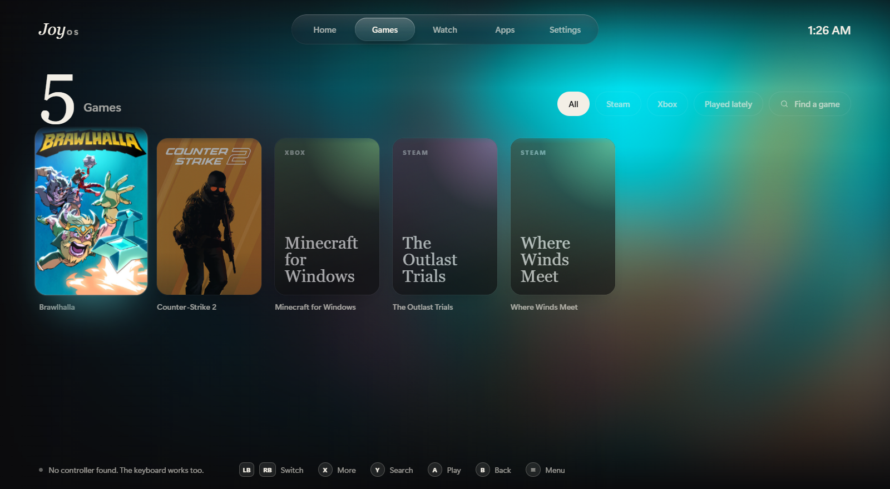
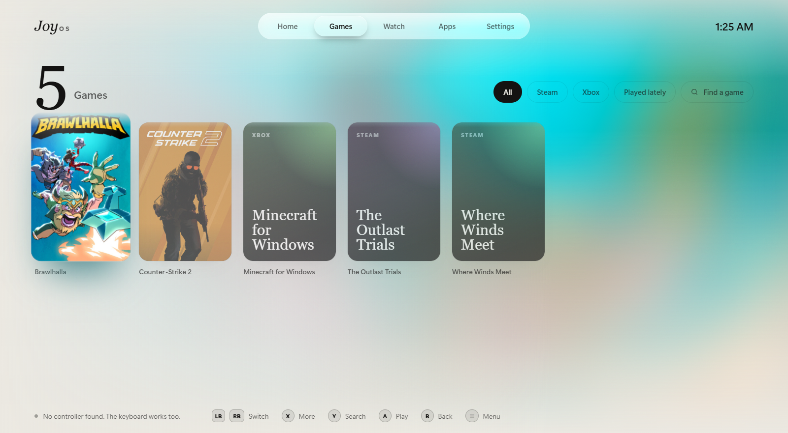
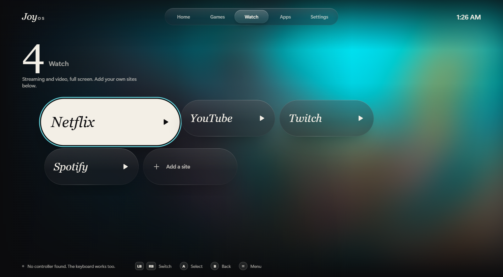
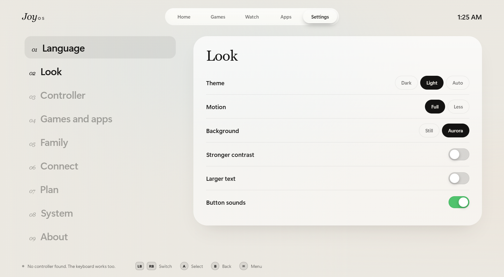

# JoyOS

JoyOS turns your Windows PC into a console you can use from the couch. Pick up a controller and you can start a game, open an app, watch a video, change the volume, or turn the PC off. You never have to reach for the mouse.

## Screenshots

<table>
  <tr>
    <td></td>
    <td></td>
  </tr>
  <tr>
    <td></td>
    <td></td>
  </tr>
</table>

More stills and short screen recordings are in [assets/marketing/](assets/marketing/).

## Getting started

```sh
cargo run --release       # full screen, like a console
cargo run -- --windowed   # in a window, handy while you're working on JoyOS
```

You need Windows 10 or 11 and Rust 1.85 or newer. Windows 11 already has everything else.

## Controls

| Controller | Keyboard | What it does |
|---|---|---|
| Left stick or arrows | Arrow keys | Move around |
| A | Enter | Play, open, or pick |
| B | Esc, Backspace | Go back |
| X | X | See more about a game |
| Y | F or / | Search |
| LB / RB | Q / E, Page Up / Page Down | Switch tabs |
| LT / RT | | Jump a page |
| Right stick | | Tilt the cover you're looking at |
| Start | M, F1 | Open the quick menu |
| **Start + View** (or the Guide button) | | Bring JoyOS back from any game or app |

**Inside other apps,** your controller acts like a mouse. The left stick moves the pointer. Hold LT to slow it down for precise clicks. The right stick scrolls. A, B, and X are left, right, and middle click. Press Y to open the on-screen keyboard. It also opens by itself when you click a text box. The D-pad sends arrow keys. LB and RB go back and forward in the browser. RT presses Enter, View presses Esc, and Start opens the quick menu.

## What you can do

**Find everything in one place.** JoyOS finds your games from Steam, Epic, GOG, Ubisoft, and Xbox Game Pass. It also finds apps from your Start menu, with their real icons. Point it at a folder of ROMs and it will list those too, opened in the emulator you pick. If you add a SteamGridDB key, it fills in cover art for games that don't have any.

**A home screen that feels like a TV.** The game you're looking at fills the screen with its artwork and logo. "Jump back in" shows your pinned games first, then the ones you played most recently. Your apps sit below.

**Games.** Browse everything, filter it by store, or search. The search keyboard follows your language's layout and remembers the words you've typed, so it can suggest them next time. Press the microphone key to say what you're looking for instead (this uses Windows' speech service, so online speech has to be on in Windows settings).

**Watch.** Streaming and video sites open full screen, ready for a controller. Netflix, YouTube, Twitch, and Spotify are there already. You can add your own sites too.

**Typing in other apps.** A JoyOS keyboard floats over whatever you're using. X deletes, Y adds a space, LT is Shift, RT is Enter, LB and RB move the cursor, and View shows symbols. There's also a Voice button that starts Windows dictation. If you'd rather use the Windows keyboard, switch to it under Settings → Controller.

**Quick menu.** From anywhere, press Start to adjust the volume and brightness, switch mouse mode on or off, take a screenshot, save the last 30 seconds of play, open the keyboard, or get to the power options.

**The whole family.** Add people to your PC, give each one a PIN, and set a daily time limit. Choose who's playing, and JoyOS keeps track of how long everyone has played, with a summary for the week and the year.

**Settings for each game.** Change how A and B are swapped, or pick a power mode, for one game at a time. JoyOS puts your settings back when you come back to it.

**Look and feel.** Choose a light or dark theme, or let it switch on its own at night. Turn on the Aurora background, make text larger, or turn up the contrast. Motion can be reduced for anyone who gets dizzy from it.

**Use your phone as a remote.** Turn it on in Settings → Connect. Your phone opens a page on your home network, you enter a code from the TV once, and then it works as a controller, a touchpad and a keyboard. The code changes after each phone joins, wrong codes make it wait a minute, and "Forget paired phones" signs every phone out. The connection isn't encrypted, so only turn it on at home.

**Power.** Sleep, restart, turn off, or drop to the Windows desktop.

**13 languages,** including right-to-left Arabic. The wording is plain and everyday. See [locales/README.md](locales/README.md) for the style guide.

**Some extras need JoyOS Plus.** Per-game settings, family profiles, syncing your settings between PCs, and add-ons are part of the Plus plan. Enter a key under Settings → Plan. Everything else is free.

## Taking JoyOS further

- **Sync between PCs.** Point JoyOS at a folder that two PCs share, such as OneDrive. Your settings stay the same on both.
- **Add-ons.** Put a `plugin.js` file in a folder under the add-ons folder (Settings → Connect), and JoyOS runs it. Each one runs walled off from the rest of JoyOS and can only show a message or open a web page. Still, only add ones you trust.
- **Full-desktop mode.** For a dedicated machine, JoyOS can make a pair of scripts. You read them first, then run them as administrator to make JoyOS the whole desktop. The second script puts Windows back.
- **Getting back to Windows.** Hold **LB + RB + View + Start** for five seconds (or press Ctrl+Alt+Shift+D) to open the Windows desktop or see how to undo full-desktop mode. If someone in the family has a PIN and no time limit, JoyOS asks for it first.
- **Updates.** If you set an update address, JoyOS checks it and lets you know when a new version is out. It never installs anything on its own.

## Where your data lives

- Settings: `%APPDATA%\JoyOS\JoyOS\config\settings.toml`
- Cover art, app icons, and plugins: `%LOCALAPPDATA%\JoyOS\JoyOS\data`
- Crash logs (only if you turn them on): the same data folder. Nothing is ever sent anywhere.

## For developers

JoyOS is written in Rust. The screens are built with Dioxus 0.7 and shown in the Windows web view. Focus and movement are handled by a small script that picks the next item from where things sit on the screen. Rust handles everything else.

| Path | What's in it |
|---|---|
| `src/app.rs` | Shared state, input handling, sessions, the main screen |
| `src/input.rs` | Controller reading: movement, mouse mode, rumble, battery |
| `src/osk.rs` | The keyboard window that floats over other apps |
| `src/companion.rs` | The phone remote |
| `src/library/` | Finding games and apps from each store, plus cover art and icons |
| `src/household.rs` | PINs, daily limits, and play stats |
| `src/license.rs` | Checking Plus and Business keys, offline |
| `assets/js/nav.js` | Focus and movement with a controller or keyboard |
| `assets/css/` | Colors, glass effects, animation, and every screen's styles |
| `assets/remote/` | The phone remote's web pages |
| `src/ui/` | The screens and the panels that open on top of them |
| `locales/` | Translations, one folder per language |
| `tools/` | Developer helpers, including the license key tool |
| `assets/marketing/` | Screenshots and screen recordings of the screens |

Run the checks with:

```sh
cargo test
cargo clippy --all-targets -- -D warnings
```

Build the installers (a per-user setup and an MSI, in `target/release`) with [cargo-packager](https://github.com/crabnebula-dev/cargo-packager). It downloads NSIS and WiX by itself. The installers aren't code-signed; signing needs your own certificate.

```sh
cargo install cargo-packager --locked
cargo packager --release
```

Debug builds open a developer port on `127.0.0.1:9333`. You can point a Chromium-based browser's inspector at it, such as `edge://inspect`, to look at the screens.

The fonts are Inter and Instrument Serif, both under the SIL Open Font License. The license files are in `assets/fonts/`.
